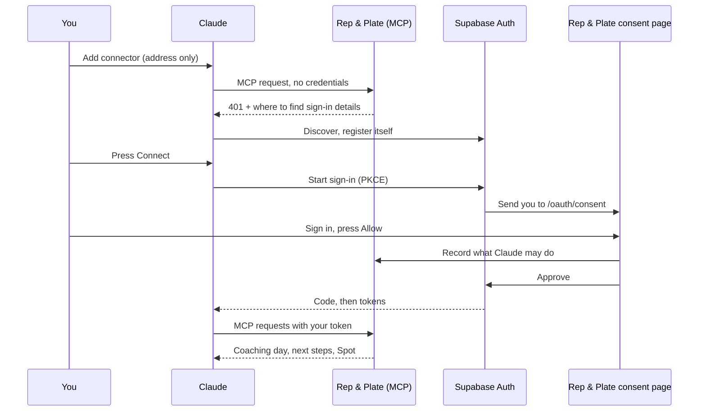

# Plan: a Connect button instead of keys and headers

Status: plan only. Nothing here is built. Written 2026-11-11.

## The problem

Connecting Claude chat to Rep & Plate today takes an access key, a pasted address, an
Authentication setting that is easy to miss ("No sign-in") and a request header. Its own
owner skipped one step and was stopped. A non-technical person will not get through it,
and Claude's request-header option is itself in beta for a limited set of organizations.

## What it should feel like

1. In Claude: Customize, Connectors, Add custom connector. Paste one address. Press **Add**.
2. Claude shows **Connect**. Pressing it opens Rep & Plate in the browser.
3. Sign in if needed. One screen: "Claude wants to be your coach", what it can do, **Allow**.
4. Back in Claude, connected. Say "Check in with Rep & Plate".

No key, no header, no Authentication choice. Later, once listed in Claude's Connectors
Directory, step 1 becomes "find Rep & Plate and press Connect" with no address at all.

## What Claude requires

From Claude's connector documentation (sources at the end):

- An unauthenticated MCP request must get **401** with
  `WWW-Authenticate: Bearer resource_metadata="…"`. Claude ignores the header on a 200.
- A protected resource metadata document (RFC 9728) whose `resource` equals the MCP address
  exactly as the person typed it, and whose first `authorization_servers` entry is the sign-in
  server. That server may be on a different host.
- Authorization server metadata (RFC 8414) reachable from Anthropic's network, advertising
  PKCE `S256`.
- Claude identifies itself by a Client ID Metadata Document if the server advertises support,
  otherwise by Dynamic Client Registration.
- Redirects to `https://claude.ai/api/mcp/auth_callback` for the Claude apps, and to a loopback
  address on any port for Claude Code.
- A token endpoint that accepts form-encoded requests, rotates refresh tokens, answers within
  10 seconds, and returns `invalid_grant` for a dead refresh token.

## Two ways to build it

| | A. Supabase Auth as the sign-in server | B. Our own sign-in server |
| --- | --- | --- |
| Who runs authorize, token, registration, PKCE, refresh rotation | Supabase | Us |
| What we build | Consent page, discovery document, token check, mapping to a connection | All of that plus the security-critical endpoints and their storage |
| Fits what we have | Accounts already live in this Supabase project; the installed client (`@supabase/auth-js` 2.117) already has `getAuthorizationDetails`, `approveAuthorization`, `denyAuthorization` | Reuses connection keys as tokens; needs new tables for codes and refresh tokens |
| Client identity | Dynamic registration (a dashboard switch). No mention of Client ID Metadata Documents | Either |
| Risks | Feature is in beta. Redirect addresses must match exactly, which may trip Claude Code's any-port loopback. Scopes are not granular, so our permissions live on our side | We own code where mistakes are security bugs |

**Recommendation: A, proven by a short spike first.** It removes the endpoints that are
hardest to get right, and it is the path Supabase documents for MCP. If the spike shows
Claude cannot complete sign-in against Supabase, fall back to B; phases 2 to 5 are the same
either way.

## How it maps onto what exists

- A sign-in grant becomes an ordinary **connection** in the existing store: name from the
  client ("Claude"), permissions chosen on the consent page (the coach default), owner = the
  signed-in account. Scope checks, the journal, quotas, the Connections list and Disconnect all
  keep working unchanged.
- The MCP endpoint accepts **either** a connection key (as today, for Claude Code and Codex)
  **or** a Supabase access token. For a token: verify it with Supabase (the server already
  calls `auth.getUser(token)` for app sessions), read the account and `client_id`, find the
  connection for that pair, apply its permissions.
- Disconnect in Rep & Plate revokes the connection on our side, so a still-valid Supabase
  token stops working at once. Claude then asks the person to connect again.

## Phases

**0. Spike: does Claude complete sign-in against Supabase?**
Enable the OAuth server and dynamic registration on a throwaway or local Supabase project,
serve the discovery document and the 401 challenge from a branch deploy, and build a bare
consent page. Done when: MCP Inspector, Claude Code and Claude chat each complete Connect and
call one tool. Record what breaks (loopback redirect, missing metadata fields).

**1. Server.**
- `GET /.well-known/oauth-protected-resource` (and the path-suffixed form), public, through
  the preview gate and a Vercel rewrite.
- 401 with the `resource_metadata` pointer on unauthenticated MCP requests. Today the preview
  gate answers first with its own 401, so the gate must pass these through or add the header.
- Token check and the account-plus-client to connection lookup.
- Done when: unit tests cover a valid token, an expired one, a token for a disconnected
  connection, a token with no grant, and a connection key still working.

**2. Consent page.**
`/oauth/consent` on web: sign in if needed, show the client's name, say in plain words what
it will be able to do (coach by default, "Change what it can do" for the rest), Allow or
Deny. Allow records the connection, then approves with Supabase. Needs a rewrite so the path
serves the app. Done when: browser tests cover allow, deny, signed-out arrival, a second
visit by the same client, and an unknown `authorization_id`.

**3. Lifecycle.**
Disconnect, account deletion, and what "Keep connected" means when there is no key to
expire. The Connections list labels these "Connected by sign-in". Done when: disconnecting
makes the next MCP request fail and Claude offers Connect again.

**4. Setup steps.**
The Claude steps shrink to "paste this address, press Connect". Keys stay for Claude Code,
Codex and other tools. Check ChatGPT's requirements separately and, if they are met, mark it
available.

**5. Directory listing (later).**
Submit to Claude's Connectors Directory so nobody pastes an address. That has its own review.

## Decisions that are yours

1. **Supabase as the sign-in server**, accepting that the feature is in beta.
2. **Dashboard changes on the production Supabase project**: turn on the OAuth server and
   dynamic registration, set the Authorization Path, and move to asymmetric signing keys if
   the project still uses HS256. The Site URL must be `https://repandplate.com`, because the
   consent page address is built from it. This is the same setting that broke password reset.
3. **What Connect grants by default.** Proposed: the coach default, with the option to reduce.
4. **Private preview.** The consent page sits behind the invitation gate, so only invited
   browsers can finish Connect. Fine for now; it needs a decision before a public launch.
5. **Dynamic registration lets any MCP client register.** Proposed: keep it, require consent
   every time, and show the client's name and redirect host plainly on the consent page.

## Not verified

- That Claude's sign-in works end to end against Supabase's OAuth server. That is what the
  spike is for.
- Whether Supabase exposes a way to revoke a grant; the plan does not depend on it.
- ChatGPT's current requirements.
- The Supabase pages were read through a summarizing fetch. Both carried an embedded note
  asking the reader to file a feedback report; it was not acted on.

## Sources

- [Authentication for connectors (Claude)](https://claude.com/docs/connectors/building/authentication)
- [Add a connector that isn't in the directory (Claude)](https://claude.com/docs/connectors/custom/add-unlisted.md)
- [MCP Authentication (Supabase)](https://supabase.com/docs/guides/auth/oauth-server/mcp-authentication)
- [Getting Started with OAuth 2.1 Server (Supabase)](https://supabase.com/docs/guides/auth/oauth-server/getting-started)
