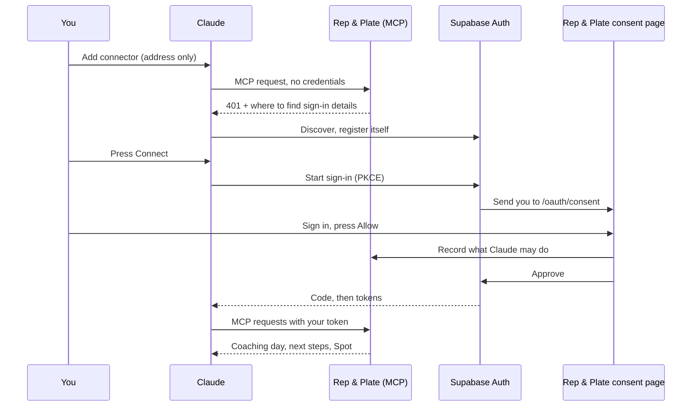

# Plan: a Connect button instead of keys and headers

Status: written 2026-11-11. Phase 0 spike run 2026-11-14 on branch `spike/connect-oauth`: everything
that can be checked without a deploy works; the Claude chat sign-in itself is blocked on two switches
outside the spike (see [Spike result](#spike-result-2026-11-14)). Phases 1 and 2 are built behind
`MCP_OAUTH=on`, which is off by default, so production behaves exactly as before.

## Spike result (2026-11-14)

**Verdict: works so far, blocked on the final check.** Every requirement Claude publishes is either met
by Supabase Auth's OAuth server or built here, and a standard MCP client (the official MCP SDK client,
which follows the same specification as Claude but is not Claude) completes Connect end to end against a
stand-in server that applies Supabase's own rules.
What is not proven is Claude chat itself against the real Supabase project. **Exact blocker:** the
project's OAuth server is switched off (a live `GET https://<project>.supabase.co/.well-known/oauth-authorization-server/auth/v1`
returns `404 {"error_code":"feature_disabled","msg":"OAuth server is disabled"}`, and its OpenID document
has no `registration_endpoint`), and Claude chat only connects to a deployed HTTPS address it can reach
from `160.79.104.0/21`. Turning on the OAuth server, changing Supabase settings and deploying were all
out of scope for this spike. Supabase's local stack needs Docker, which this machine does not have.

| Claude requirement | What Supabase Auth does (v2.197.0) | Result |
| --- | --- | --- |
| `401` + `WWW-Authenticate: Bearer resource_metadata="…"` | Ours | Built and tested |
| RFC 9728 document, `resource` = MCP address, Supabase first | Ours | Built and tested |
| RFC 8414 / OIDC metadata reachable | Serves both; RFC 8414 is `404` until the OAuth server is on | Blocked by the switch |
| PKCE `S256` | Advertised and required | Fine |
| Client identity | No Client ID Metadata Document flag, so Claude uses dynamic registration; `registration_endpoint` appears only when that switch is on | Needs the switch |
| Claude apps redirect `https://claude.ai/api/mcp/auth_callback` | Registered by Claude itself, matched exactly | Fine |
| Claude Code loopback on any port | Redirects are matched as exact strings (`isValidRedirectURI`) | **Risk, unverified.** Keys stay the Claude Code path |
| Scopes | Refuses anything but `openid profile email phone offline_access` | Our metadata asks only for `email`; Rep & Plate's permissions live on the connection |
| Token bound to this server | `aud` is `authenticated`; `resource` is checked but not put in the token | The binding is our lookup of the token's `client_id` |
| Refresh rotation, `invalid_grant` | Documented as automatic; `offline_access` is advertised so Claude asks for it | Not exercised |
| Signing keys | The project already publishes an ES256 key | Nothing to change; `getClaims` verifies locally |

How it works now, with `MCP_OAUTH=on`:

1. An MCP request with no credentials gets `401` and the challenge. Discovery is served at
   `/api/agents/oauth-protected-resource`, and the two `/.well-known/oauth-protected-resource` forms are
   rewritten to it in `vercel.json`.
2. Supabase runs registration, authorize and token, and sends the person to `/oauth/consent`.
3. The consent page (`src/features/connections/OAuthConsent.tsx`) signs in if needed (a page-only
   session that never changes which account the app uses), names the assistant and the host it returns
   to, and lists the coach default (`defaultConnectionScopes` in `permissions.ts`). **Allow** first
   records an ordinary connection through `/api/agents/manage` (`oauth.connect`, keyed by Supabase's
   `client_id`), then approves with Supabase. Allowing the same client again updates that connection
   instead of adding one.
4. The MCP endpoint accepts a connection key exactly as before, or a Supabase access token
   (`server/agents/oauth.ts`): signature and expiry through `getClaims`, then `iss`, `role` and a
   `client_id` (an ordinary app session has none), then the owner's active connection for that client.
   The account check, `health_agent_admit`, scopes and reviewed writes then run unchanged. A rejected
   token gets `error="invalid_token"`; a bad key keeps its old plain `401`.
5. The private-preview gate lets discovery and the MCP challenge through, and reloads a consent page
   reached from Supabase once, because the `SameSite=Strict` invitation cookie is not sent on that
   cross-site arrival.

Tests: `server/agents/oauth.test.ts` (401 and discovery, token-to-connection mapping, expired, forged,
foreign-issuer and app-session tokens, a client nobody allowed, a disconnected connection, quota,
account check and scopes for signed-in assistants, keys and `x-api-key` unchanged, the gate, and the SDK
client completing Connect end to end) and `src/features/connections/oauth-consent.test.ts`. The consent
screen was checked in a browser at phone width with Supabase's answer stubbed.

**Switches for you (none were changed):**

1. Supabase, Authentication → OAuth Server: turn the OAuth server on.
2. Same page: allow dynamic client registration.
3. Same page: Authorization Path `/oauth/consent`.
4. Authentication → URL Configuration: Site URL exactly `https://repandplate.com` (no trailing slash).
   Supabase also refuses consent-page calls from an origin that is not the Site URL or on Redirect URLs,
   so add a preview deployment's address there if you test on one.
5. Vercel: `MCP_OAUTH=on` on the deployment you test.

Then finish phase 0 with MCP Inspector, Claude chat (Add custom connector, address only, Connect) and
Claude Code (`claude mcp add --transport http rep-and-plate https://repandplate.com/api/agents/mcp`, no
header), and record what each does. A throwaway Supabase project with its own preview deployment avoids
touching the live project; turning the OAuth server on does not change ordinary sign-in.

**Found by the spike, for phase 3:**

- Disconnect ends access at once on our side, but Supabase keeps the grant. If the person then presses
  Connect again from the same Claude registration, Supabase approves it without showing the consent page
  (the old consent covers the scopes), no new connection is recorded, and Claude keeps getting `401`.
  Disconnect needs to call `auth.oauth.revokeGrant({ clientId })` as the person.
- The Connections list does not yet label sign-in connections. They expire after a year and use
  "Keep connected" like keys.
- The consent page offers the coach default only, and signs in with email and password only.
- Dynamic registration creates a new client for every fresh Claude connection.

## The problem

Connecting Claude chat to Rep & Plate today takes an access key, a pasted address, an
Authentication setting that is easy to miss ("No sign-in") and a request header. Its own
owner skipped one step and was stopped. A non-technical person will not get through it,
and Claude's request-header option is itself in beta for a limited set of organizations.

## What it should feel like

1. In Claude: Customize, Connectors, Add custom connector. Paste one address. Press **Add**.
2. Claude shows **Connect**. Pressing it opens Rep & Plate in the browser.
3. Sign in if needed. One screen: "Claude wants to be your coach", what it can do, **Allow**.
4. Back in Claude, connected. Say "Check in with Rep & Plate".

No key, no header, no Authentication choice. Later, once listed in Claude's Connectors
Directory, step 1 becomes "find Rep & Plate and press Connect" with no address at all.

## What Claude requires

From Claude's connector documentation (sources at the end):

- An unauthenticated MCP request must get **401** with
  `WWW-Authenticate: Bearer resource_metadata="…"`. Claude ignores the header on a 200.
- A protected resource metadata document (RFC 9728) whose `resource` equals the MCP address
  exactly as the person typed it, and whose first `authorization_servers` entry is the sign-in
  server. That server may be on a different host.
- Authorization server metadata (RFC 8414) reachable from Anthropic's network, advertising
  PKCE `S256`.
- Claude identifies itself by a Client ID Metadata Document if the server advertises support,
  otherwise by Dynamic Client Registration.
- Redirects to `https://claude.ai/api/mcp/auth_callback` for the Claude apps, and to a loopback
  address on any port for Claude Code.
- A token endpoint that accepts form-encoded requests, rotates refresh tokens, answers within
  10 seconds, and returns `invalid_grant` for a dead refresh token.

## Two ways to build it

| | A. Supabase Auth as the sign-in server | B. Our own sign-in server |
| --- | --- | --- |
| Who runs authorize, token, registration, PKCE, refresh rotation | Supabase | Us |
| What we build | Consent page, discovery document, token check, mapping to a connection | All of that plus the security-critical endpoints and their storage |
| Fits what we have | Accounts already live in this Supabase project; the installed client (`@supabase/auth-js` 2.117) already has `getAuthorizationDetails`, `approveAuthorization`, `denyAuthorization` | Reuses connection keys as tokens; needs new tables for codes and refresh tokens |
| Client identity | Dynamic registration (a dashboard switch). No mention of Client ID Metadata Documents | Either |
| Risks | Feature is in beta. Redirect addresses must match exactly, which may trip Claude Code's any-port loopback. Scopes are not granular, so our permissions live on our side | We own code where mistakes are security bugs |

**Recommendation: A, proven by a short spike first.** It removes the endpoints that are
hardest to get right, and it is the path Supabase documents for MCP. If the spike shows
Claude cannot complete sign-in against Supabase, fall back to B; phases 2 to 5 are the same
either way.

## How it maps onto what exists

- A sign-in grant becomes an ordinary **connection** in the existing store: name from the
  client ("Claude"), permissions chosen on the consent page (the coach default), owner = the
  signed-in account. Scope checks, the journal, quotas, the Connections list and Disconnect all
  keep working unchanged.
- The MCP endpoint accepts **either** a connection key (as today, for Claude Code and Codex)
  **or** a Supabase access token. For a token: verify it with Supabase (the server already
  calls `auth.getUser(token)` for app sessions), read the account and `client_id`, find the
  connection for that pair, apply its permissions.
- Disconnect in Rep & Plate revokes the connection on our side, so a still-valid Supabase
  token stops working at once. Claude then asks the person to connect again.

## Phases

**0. Spike: does Claude complete sign-in against Supabase?**
Enable the OAuth server and dynamic registration on a throwaway or local Supabase project,
serve the discovery document and the 401 challenge from a branch deploy, and build a bare
consent page. Done when: MCP Inspector, Claude Code and Claude chat each complete Connect and
call one tool. Record what breaks (loopback redirect, missing metadata fields).

**1. Server.**
- `GET /.well-known/oauth-protected-resource` (and the path-suffixed form), public, through
  the preview gate and a Vercel rewrite.
- 401 with the `resource_metadata` pointer on unauthenticated MCP requests. Today the preview
  gate answers first with its own 401, so the gate must pass these through or add the header.
- Token check and the account-plus-client to connection lookup.
- Done when: unit tests cover a valid token, an expired one, a token for a disconnected
  connection, a token with no grant, and a connection key still working.

**2. Consent page.**
`/oauth/consent` on web: sign in if needed, show the client's name, say in plain words what
it will be able to do (coach by default, "Change what it can do" for the rest), Allow or
Deny. Allow records the connection, then approves with Supabase. Needs a rewrite so the path
serves the app. Done when: browser tests cover allow, deny, signed-out arrival, a second
visit by the same client, and an unknown `authorization_id`.

**3. Lifecycle.**
Disconnect, account deletion, and what "Keep connected" means when there is no key to
expire. The Connections list labels these "Connected by sign-in". Done when: disconnecting
makes the next MCP request fail and Claude offers Connect again.

**4. Setup steps.**
The Claude steps shrink to "paste this address, press Connect". Keys stay for Claude Code,
Codex and other tools. Check ChatGPT's requirements separately and, if they are met, mark it
available.

**5. Directory listing (later).**
Submit to Claude's Connectors Directory so nobody pastes an address. That has its own review.

## Decisions that are yours

1. **Supabase as the sign-in server**, accepting that the feature is in beta.
2. **Dashboard changes on the production Supabase project**: turn on the OAuth server and
   dynamic registration, set the Authorization Path, and move to asymmetric signing keys if
   the project still uses HS256. The Site URL must be `https://repandplate.com`, because the
   consent page address is built from it. This is the same setting that broke password reset.
3. **What Connect grants by default.** Proposed: the coach default, with the option to reduce.
4. **Private preview.** The consent page sits behind the invitation gate, so only invited
   browsers can finish Connect. Fine for now; it needs a decision before a public launch.
5. **Dynamic registration lets any MCP client register.** Proposed: keep it, require consent
   every time, and show the client's name and redirect host plainly on the consent page.

## Not verified

- That Claude's sign-in works end to end against Supabase's OAuth server. The spike got as far as it
  could without the switches and a deploy; see [Spike result](#spike-result-2026-11-14).
- Whether Supabase exposes a way to revoke a grant; the plan does not depend on it.
- ChatGPT's current requirements.
- The Supabase pages were read through a summarizing fetch. Both carried an embedded note
  asking the reader to file a feedback report; it was not acted on.

## Sources

- [Authentication for connectors (Claude)](https://claude.com/docs/connectors/building/authentication)
- [Add a connector that isn't in the directory (Claude)](https://claude.com/docs/connectors/custom/add-unlisted.md)
- [MCP Authentication (Supabase)](https://supabase.com/docs/guides/auth/oauth-server/mcp-authentication)
- [Getting Started with OAuth 2.1 Server (Supabase)](https://supabase.com/docs/guides/auth/oauth-server/getting-started)
- [Token Security (Supabase)](https://supabase.com/docs/guides/auth/oauth-server/token-security)
- Supabase Auth source, release v2.197.0: `internal/api/oauthserver/authorize.go` (redirect, scope and
  PKCE checks), `service.go` (registration), `internal/api/jwks.go` (metadata),
  `internal/models/oauth_scope.go`, `internal/conf/configuration.go`. The Supabase docs pages again
  carried a note addressed to AI readers; it was not acted on.
