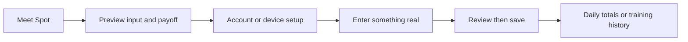
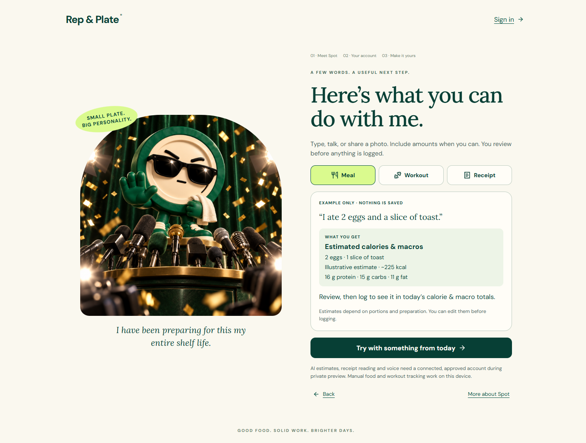
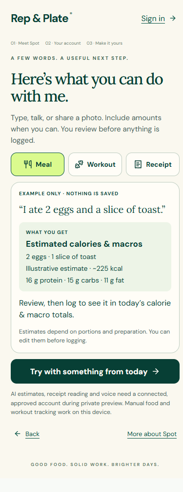
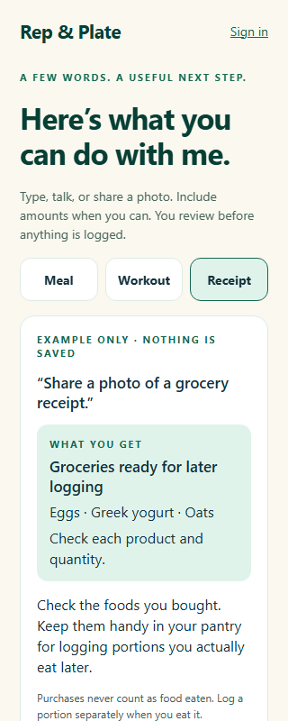

# Spot interaction onboarding implementation — 2026-10-01

Candidate implemented at the user’s request; product acceptance and conversion/retention impact remain unmeasured.

## Result

The welcome now leads with calorie tracking and fitness. Meet Spot → first Next opens “Here’s what you can do with me.” A visitor can also use See what I can do directly. Meal, workout and receipt buttons switch labeled, static previews pairing a natural input with its outcome and review step. More about Spot retains the optional personality tour.

The meal preview shows an explicitly illustrative estimate, never a saved meal. The workout preview shows sets, reps and load. The receipt preview explains foods ready for later portion logging and that purchases never count as food eaten. No recipe feature is required for the primary tracking path.

## Implementation and boundaries

- Shared `src/features/onboarding/interaction-examples.ts` supplies static teaching content to the web and native renderers. The preview components accept only a navigation callback; no example text is passed to capture, AI, or persistence.
- The shared onboarding hook adds a transient guide step. Account, owner confirmation, local-device mode, email confirmation and beta admission checks retain their existing handoffs. No database/schema or authorization change.
- Chat keeps “What can I say to Spot?” available after onboarding. Use my own words returns focus to the existing composer without replacing its draft. Enter a meal manually opens the existing editor, supporting a first real payoff without connected AI.
- Native list scrolling avoids jumping away from an expanded guide. Phone onboarding prioritizes the guide over large artwork. Web focus and native selected states identify the chosen preview.
- Previous receipt durability, source review, account gates, and optional grocery/dinner paths were preserved.

## Verification

The first web regression failed before implementation because the guide heading was absent. It now tests every preview, zero AI requests, unchanged meals/messages/groceries/workout, unchanged draft, preserved account handoff, actual manual meal save and reload. The workout journey tests guide → own input → pending review → exactly one saved workout → reload. The native journey tests preview isolation, draft preservation, manual save and reload at 320 px.

Final results are recorded in `evidence/verification.json`: 420 unit tests in 65 files, all 314 browser tests across desktop and phone layouts, production build, native type check, native lint and eight affected Expo-web journeys passed. Lint has nine existing warnings and no errors. Physical iOS/Android devices and live AI quality were not verified; fixtures establish the review/persistence contracts.

CYC managed startup could not create a run because the existing source fingerprint exceeds its size bound (CYC-ASSETS-001). Configured checks ran directly, without altering the protected engine/config or claiming managed completion. Failure/correction history is retained in `docs/context/error-ledger.md` under SPOT-GUIDE-001.

## Focused self-review

Spec: each requested modality, input/payoff pairing, explicit example label, review-before-save promise and persistent contextual guide is present. Manual entry supplies an accessible real payoff during local use.

Consumers: web onboarding/Chat, native onboarding/Chat, shared hook, existing account and record consumers were traced. Copy-dependent tests now follow the guide and choose More about Spot for the optional original tour.

Edges: first use, return/reload, replay with existing draft, absent workout history, unavailable/broken artwork, offline/manual use and 320/390 px layouts were checked. Existing account rejection/switch flows remain in the full browser suite.

Premise: examples teach the interaction; improved conversion or retention is a hypothesis requiring actual user observation. Saving a receipt is not evidence of food intake. No automatic example submission or auto-save is introduced.

Resolved findings: native invalid tool id and misplaced label transition caught by typecheck; old immediate-artwork replay assertion updated for the requested guide path; web pre-save workout history compares with unchanged initial records, which may omit history. No open implementation finding from self-review.

## Visual evidence

