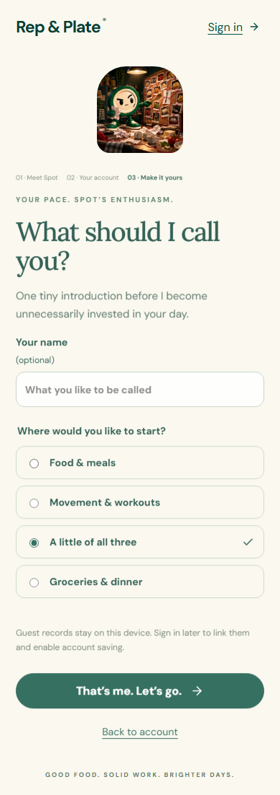
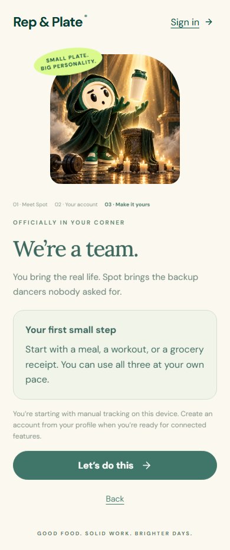

# Combined onboarding choice — 2026-10-01

Changed the combined option from **A little of both** to **A little of all three** on web and native. It remains selected by default. Its ready-screen guidance includes a meal, workout or grocery receipt, at the user's pace. Receipt-specific ready guidance now describes checking purchases and logging portions later.

Shared `defaultFocus` and `firstStepForFocus` in the existing onboarding model keep both renderers aligned. Chat account setup uses the same fallback when no prior onboarding record exists. Existing saved focus strings are still readable; no records are migrated and account boundaries/routing remain unchanged.

The expanded web record-preservation test failed before repair because the new default label was absent. Final verification checks the selected default, combined ready copy, existing records and composer draft. Native checks confirm the label and actual saved focus after setup, plus existing account and storage-failure journeys. An initial native assertion expected aria-checked from the existing accessibilityState renderer; Expo web omits that attribute, so the test verifies the persisted selected default instead.

CYC managed startup remains unavailable at the existing fingerprint size bound; checks run directly, with logs in evidence. The first broad browser run was interrupted after finding the account fallback consumer; final verification runs on the corrected files. Results are finalized in evidence/verification.json. No physical phone or live AI quality verification is claimed for this copy change.

Self-review: intent matches the user's three-way combined choice; consumers include shared model, web/native setup and ready screen, and account fallback. Legacy focus values remain accepted. No open implementation finding. Candidate is ready for user review; acceptance is not inferred.

The first completed browser pass had 313 passes and one timeout in existing Connections setup, before storage-failure injection. Three isolated repeats passed without code changes. A full repeat runs without competing builds or native startup; evidence retains both results rather than hiding the timeout.

Final results: 420 unit tests, 314 browser tests across desktop/phone, four Expo-web native onboarding journeys, build and native types passed. Native lint has zero errors and nine existing warnings. The full exclusive browser repeat passed in 3.7 minutes; the original timeout remains disclosed above. Seven scoped source hashes stayed unchanged during final checks.
