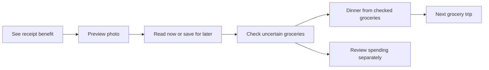

# Receipt journey implementation and verification

October 1, 2026. The web flow now explains why to upload a receipt before account setup, offers a record-free example, preserves a chosen photo through access setup, and connects a successful read to dinner and spending. These changes address the five priorities in the [six-persona audit](../2026-10-01-receipt-value/report.md). They are implemented locally and await user acceptance; they are not evidence of improved conversion.

## What changed

| Audit finding | Implemented behavior | Evidence |
| --- | --- | --- |
| Receipt benefit appears late | Receipt-first welcome, example with dinner and missing ingredients, explicit Chat entry and receipt-focused setup | Onboarding and receipt journey browser checks; welcome and example captures |
| Guest access and saved recovery unclear | Sign-in/setup/restricted/service states; preview and optional note retained on cancel/linking; saved photos readable after refresh | Guest-linking, recovery and inconclusive-reread browser checks |
| Extraction ends at storage | Checked versus uncertain food counts, receipt-scoped dinner action and independent spending review | Connected receipt → review → spending → dinner fixture; no intake or stock mutation |
| Checks and correction effort confusing | Exclude used stock, allow dinner from checked subset, compare original photo, retain rejected edit draft and offer stock adjustment | Readiness unit cases and quantity-history browser rejection |
| Privacy and repeat-use unclear | Device/private account copy wording, optional targets/preferences, next receipt after exhausted stock and completed loop | Account capture and repeat-use browser checks; source review |

The original mint, cream, rounded controls and Spot imagery are retained. The example is clearly labeled and isolated from personal records. No saved meal or pantry deduction occurs until the existing explicit consumption flow. Unknown products, quantities and prices remain unknown. No guaranteed saving or receipt-reading speed is advertised.

## Engineering decisions

Saved receipt intent and a linked capture-review ID are optional persisted message fields, so existing web/native records remain parseable. A one-time upgrade recognizes only unresolved grocery-receipt image notes. Success resolves that source review without touching other reviews. Request identity is reused for interrupted requests, but renewed for completed inconclusive reads so server caching does not replay the same unsuccessful result. Successful purchases retain existing deduplication.

Original-photo comparison uses the receipt answer's existing request relationship. Readiness is derived from current pantry amounts rather than a second stored status. Dinner prompts are scoped to the selected receipt and prohibit intake/stock changes; spending retains its existing price-review rules. Account linking preserves an unsent capture only in the intentional guest-upgrade path; account separation and cancellation are covered by existing and new tests.

The native interface is outside this web audit implementation. Shared contracts and helper consumers are checked with native type checking, lint and focused onboarding/tour/purchase journeys in the Expo web runtime. Native assertions include the shared receipt slide. These runtime checks do not establish physical-phone behavior. [Maintenance decisions](../../context/receipt-journey.md) describe the source boundaries.

Dinner requests from receipt cards, Kitchen and Pantry share one handler. During an existing response, sign-in or an outage, it retains the requested text in the composer rather than silently losing it. Access setup never submits that waiting draft automatically. Latest-state product-correction errors propagate synchronously through the web record store and leave the editor open.

## Verification and review

The first new discovery/recovery tests failed against the original UI. An additional inconclusive-read case failed on its missing recovery action before the repair. New checks cover state isolation, reload, explicit guest record linking, retained source image/context, fresh reread identity, rejected correction drafts, direct dinner/spending and used-stock repeat use. Existing meal logging, product matching, planning, shopping and account separation tests remain part of the full browser suite.

A pending-response check reproduced a discarded second dinner request and now verifies that draft is retained without a duplicate provider request. The first full suite also found Spot replay tests expecting the old slide order. They now explicitly include the added receipt-benefit slide while retaining tracking, movement, failed-art and draft-preservation checks; the affected set passed before the final full verification.

See [verification evidence](evidence/verification.json) for executed commands, results and visual observations; logs and screenshots are retained beside it. These are controlled-provider checks, not live OCR. A fixture-only navigation failure was corrected by closing the existing Pantry dialog after leaving purchase review; no forced click or test threshold was used. The ledger retains failed attempts under receipt journey recovery.

Self-review covered persistence, retry identity, account ownership, source-photo relationship, unknown amounts/prices, intake boundaries, mobile fit, semantic actions and optional preferences. The isolated example performs no mutation or provider request. Production authentication and private-preview approval policies remain authoritative. Existing unrelated workspace changes were preserved.

Visual inspection caught and repaired an enlarged receipt widening the correction form inside the modal. The strengthened browser check covers both document and dialog overflow, source disclosure by keyboard, dinner-button focus and source zoom at 320, 390 and 1100 pixels. See [visual results](evidence/visual-check.json), the [mobile welcome](evidence/welcome-390.png), [result actions](evidence/result-actions-390.png) and [source comparison](evidence/source-320.png).

CYC managed startup hit the existing source-fingerprint size limit before a run could be created. Protected settings and engine were unchanged; the configured unit, build and browser commands were run directly. No managed-run completion is claimed.

## What still needs user research

The audit personas were simulated expert reviews. This implementation has not established real-user comprehension or conversion improvements. Use the audit's moderated tasks to ask newcomers why they would upload, have them find the action, interpret ready versus uncertain foods, correct a line and choose dinner. Test representative real receipts and physical phone cameras separately. No hosted deployment or public release is included.
