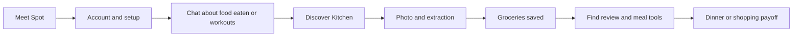
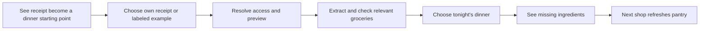

# Receipt value proposition and user journey audit

October 1, 2026. Rep & Plate already connects receipt capture to pantry stock, meal planning, missing ingredients, and reviewed grocery spending. The central gap is that newcomers meet a food and workout companion before they see why a grocery receipt is useful. After extraction, the stable result card confirms storage rather than bringing the next useful outcome into view.

This report combines six independent simulated expert personas: three UI/UX engineers and three marketers. It is an application audit, not research with six customers. Expected hesitation, abandonment, or retention effects are hypotheses. No production code was changed, no customer receipts were processed, and no market comparison establishes that this capability is unique among competitors.

## The six perspectives

| Persona | Specialty | Distinct contribution | Full review |
| --- | --- | --- | --- |
| 1 | UI/UX discovery engineer | First-use mental model, navigation and receipt discoverability | [Discovery](personas/ux-discovery.md) |
| 2 | UI/UX trust engineer | Access, disclosure, correction and recovery | [Trust](personas/ux-trust.md) |
| 3 | UI/UX activation engineer | First payoff, readiness and repeat-use state | [Payoff](personas/ux-payoff.md) |
| 4 | Positioning marketer | Audience, job to be done and reason to choose | [Positioning](personas/marketing-positioning.md) |
| 5 | Conversion marketer | Proof, effort versus reward and commitment points | [Conversion](personas/marketing-conversion.md) |
| 6 | Lifecycle marketer | Activation definition, second grocery trip and honest measurement | [Retention](personas/marketing-retention.md) |

The reviews converge on the same mechanism: the receipt's practical value is spread across separate screens. Their agreement is useful corroboration of a heuristic, not six independent customer observations.

## What someone actually gets

| Receipt contribution | Useful outcome | Conditions |
| --- | --- | --- |
| Extracted grocery lines and possible food matches | A starting pantry without typing every grocery name | Abbreviated names, products and purchased amounts may need checks; extraction is bounded |
| Reviewed products and quantities | Meal ideas and plans using known groceries | Sufficient usable ingredients, relevant preferences, connected AI for generation, and user review |
| Pantry linked to a reviewed meal plan | A list of ingredients still needed | Known stock and amounts; an upload alone does not create a complete plan |
| Confirmed purchase totals and currencies | Recorded grocery-trip spending | Uploaded and reviewed receipts only; totals may include nonfood and do not represent all household spending |
| Appropriate product and price evidence | Optional comparisons and swaps | Supported nutrition bases and checked, compatible, recent price observations; savings are not automatic |

Sources: `README.md:77`, `docs/context/shopping.md`, `src/features/planning/meal-plans.ts`, and `src/features/shopping/shopping.ts`. Receipts record purchases. They do not add eaten calories. This application does not implement cashback or a receipt reward program. The proposed reward is a more useful dinner or shopping decision; time saved, money saved, reduced waste, and health improvements have not been measured here.

## Current journey and proposed journey

The proposed first-use sequence makes the outcome visible at the beginning and connects the result to the next action. It preserves the existing review safeguards.

These are proposed changes, not implemented screens. An example may demonstrate the flow without AI access, but must remain clearly labeled and separate from personal records.

## Five changes to prioritize

### 1 Explain the receipt benefit before account setup

Observed: welcome and all four introduction slides describe Spot, food eaten, movement and encouragement. None explains receipts. The strongest existing sentence is in Kitchen: “A receipt today. Less ‘what’s for dinner?’ tomorrow.” Default Chat asks what someone ate or did, and its camera is labeled “Take a meal photo.” See `src/features/onboarding/model.ts:26`, `src/features/onboarding/Onboarding.tsx:159`, `src/features/planning/FirstWeek.tsx:24`, `src/ChatLayer.tsx:733`, and the observed [welcome](evidence/welcome.png) and [Chat](evidence/chat.png).

Recommendation: show one labeled example of a receipt becoming checked groceries, a meal idea, and missing ingredients before the account decision. Add “Start with my groceries” to the initial choices and a dedicated receipt action in first-use Chat. Retain the food/workout paths for people with a different goal.

Hypothesis to test: people will explain the receipt value and find the intended action more accurately. No conversion improvement is claimed.

### 2 Make access and saved photo recovery part of the receipt flow

Observed: unavailable capture shows “AI is unavailable” and Save my image for review, without the access-specific account action available in Chat. Saving creates an image and review note, not extracted groceries. Asking “What needs review?” reveals “Keep as a note”; there is no direct receipt-read action on that review. See `src/App.tsx:1008`, `src/App.tsx:1858`, `src/ChatLayer.tsx:258`, and [mobile guest preview](evidence/guest-preview-mobile.png), [saved review](evidence/saved-photo-mobile.png), and [walkthrough results](evidence/verification.json).

Recommendation: distinguish sign-in, preview approval and service failure in capture. Preserve the chosen photo/context through access setup and provide “Read this receipt” on the saved capture when processing becomes available. Label image saving separately from extraction success. Keep explicit submission and purchase/intake boundaries.

Validation must include cancellation, refresh, account changes, retries and exactly one resulting purchase. This is a proposed recovery mechanism, not a verified existing one.

### 3 Turn extraction success into a small useful outcome

Observed: the controlled result card says “2 grocery items saved,” “1 match needs a check,” and “Saved to groceries · not today’s intake.” It opens pantry review. A dinner action exists deeper in Pantry, while Kitchen prominently offers the week planner. See `src/AICards.tsx:95`, `src/features/pantry/PantryDialog.tsx:704`, `src/features/planning/MealPlanner.tsx:93`, and [actual controlled result](evidence/receipt-result.png).

Recommendation: present one receipt-scoped next step with its prerequisites: “Check these groceries,” then “Help me choose dinner tonight” using sufficiently checked ingredients. Keep week planning as the next expansion. Give prices their own spending action; do not require spending review for a dinner idea. Generated assistant prose can sometimes help, but should not be the only explanation of the stable journey.

Hypothesis: a concrete meal answer will communicate value better than successful storage. A usability test must establish this.

### 4 Explain what is ready and preserve correction effort

Observed: product/quantity and spending confirmations are separate. The checklist requires every food lot to be reviewed, even a used lot excluded from the visible review queue. A focused reproduction with one reviewed available food and one unresolved used food leaves the pantry step incomplete. That does not prohibit the user from opening the planner. See `src/features/planning/first-week.ts:10`, `src/features/pantry/PantryDialog.tsx:169`, and [reproduction evidence](evidence/verification.json).

Source-only findings: purchase review lacks an embedded original receipt photo; quantity-history rejection can close the details editor after the parent catches the failure. Those paths need focused interaction verification before implementation. See persona 2 for the relevant code trace.

Recommendation: explain which checks unlock the selected outcome, let people continue with ready ingredients, associate corrections with the source image, and retain drafts on rejected updates. Avoid a blanket requirement to resolve every old grocery before receiving value. Keep unknown quantities and incomplete nutrition honest.

### 5 Align privacy wording and explain the next grocery trip

Observed: upload says records stay in this browser, while optional account saving persists records and photos. This is a concrete wording inconsistency, not a finding that data is publicly exposed. The completed first-week guide falls back to its last step rather than becoming an ongoing-use summary. See `src/App.tsx:1892`, `src/features/cloud/useAccountSync.ts:117`, `src/features/cloud/media.ts:23`, and `src/features/planning/FirstWeek.tsx:17`.

Recommendation: describe AI processing, device storage and enabled account saving accurately at submission. After a useful result, show a factual recap and explain the next receipt: new purchases refresh what is available for the next meal or plan. Do not invent savings, waste avoided or a complete budget. A returning shopper should see the current next action, not another introduction.

## Proposed copy to test

**Headline:** Turn your grocery receipt into a plan for dinner.

**Supporting text:** Add a receipt, check the groceries and quantities, then plan meals from what you have and see what else you need. Purchases stay separate from what you eat.

**Primary action:** Start with my groceries.

**Secondary action:** See an example.

**Expectation:** You’ll review uncertain products and amounts. Reading your own receipt needs connected AI and an approved account during private preview.

**After extraction:** Your groceries are saved. Check the items needed for your next meal, then let Spot help you choose dinner.

This keeps Spot’s personality while making the practical exchange explicit. Household shoppers/cooks are a promising audience to test first; existing implementation does not establish their demand or justify recentering the entire application without evidence.

## Observe real use next

Recruit an initial six to eight first-time participants across household meal planners, active adults planning protein-focused meals, and people already using food trackers. Include people who dislike maintaining lists. These are research participants, distinct from the six expert lenses above. Use consented receipts with sensitive details redacted, or clearly labeled fixtures; do not require participants to disclose purchases publicly.

1. Show the current first screen briefly. Ask what the app does, why someone would provide a receipt, and what they expect in return. Do not explain receipts first.
2. Give a neutral task: “You just bought groceries. Find out whether this can help you decide dinner and your next shop.” Observe unaided action choice, navigation detours and help requests.
3. Before submission, ask what the receipt will produce, what still needs checking and where the photo goes. Test both the approved-account path and a separate guest/recovery scenario.
4. Include one ambiguous product, unknown quantity and misread total. Observe whether the participant can check the source and reach one actionable meal using valid ingredients. Ask whether purchases count as eaten calories.
5. After the result, ask “What would you do next?” Let the participant choose a meal or reviewed spending outcome. Do not count a stored photo or extracted list alone as validated activation.
6. Revisit after the participant’s next real shopping interval. Ask what a second receipt changes, then observe whether they can update purchases and continue a useful meal/shopping routine.

Compare the present flow with a receipt-first prototype using separate or counterbalanced exposure. Record comprehension, unaided discovery, help needed, time to a useful outcome, review effort and access failures separately. A small moderated study can reveal problems; it cannot establish a statistically reliable conversion lift. Agree qualitative success rules before sessions: accurate benefit and storage explanation, no confusion about purchased versus eaten, and an unaided route to a useful result. Quantitative thresholds need a baseline and adequate sample.

If analytics are subsequently authorized, distinguish capture started, image saved, extraction success, relevant checks completed, first useful meal/spending outcome, and a second distinct grocery trip. Deduplicate retries and photographs. Do not include receipt images, text, product names, prices or dietary restrictions in analytics by default. Cross-user shopping analytics are not implemented today.

## Checks and limitations

- All six persona reports were produced and reviewed against current source. Historical context was checked for freshness; existing FirstWeek and review-queue improvements were not misreported as absent.
- Existing focused Playwright suites passed **36 of 36** cases across desktop and mobile: onboarding, receipt capture, product review, shopping/spending, price review and pantry-backed planning. Command and result are retained in `evidence/verification.json`.
- An additional isolated mobile walkthrough exercised unavailable processing, saved-photo review, controlled extraction and pantry entry. It recorded **zero page errors** and retained screenshots and text. Its status and provider responses were controlled; it does not establish live authentication, OCR quality or live meal-generation quality.
- The all-lots readiness mismatch was reproduced with the current `firstWeekSteps` function. The suspected cook-button routing issue was checked and dismissed: `action: 'planner'` maps correctly. Quantity-editor rejection and source-photo findings remain source-based, with targeted verification proposed.
- Agent-browser inspected welcome, tour, guest setup, Chat and Kitchen. Its file-upload attempt produced an image-open error, while Playwright with the same fixture succeeded. That automation-specific result is not evidence of a product-wide receipt-image defect. Playwright provides the retained upload evidence.
- No production changes, fixes, full regression run, physical camera test, assistive-technology trial, representative receipt benchmark, live account/email test, customer conversion result or competitor comparison is claimed. The public invitation page was reviewed from source, not a live deployment.
- CYC managed-run startup failed before creating a run because selected source exceeds its 128 MiB/20,000-file limit. Retained history documents this as `CYC-ASSETS-001`. Direct task-specific checks were used; protected configuration was unchanged and no managed-run completion is claimed.

Recommendations are retained audit findings awaiting product decisions and real-user validation. The existing error ledger was read and preserved. Tooling failures and the corrected walkthrough assumption are recorded in [audit notes](evidence/audit-notes.md). The next concrete artifact should be a reviewable receipt-first entry and post-upload prototype, followed by observed usability sessions.
