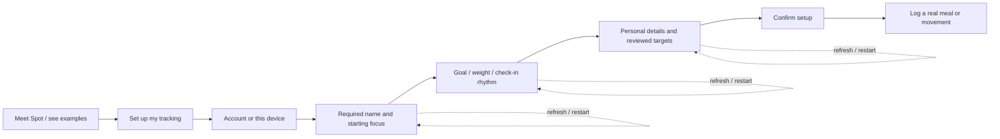

# Onboarding polish — October 2

Implemented the authorized next scope from the [smoothness review](../2026-10-02-onboarding-smoothness/review.md) across web and native. Working implementation awaits user acceptance; this is functional verification, not a measured conversion or usability result.

## Changes and rationale

- The example guide now says **Set up my tracking**, accurately naming the destination. Optional extra Spot slides remain optional. Required name, the combined focus choice last, and the existing goal/body information remain.
- Onboarding target forms have one primary action and **Skip targets for now**. Manual targets and saving details alone remain available under **Other ways to set targets**. Profile target editing retains its existing direct actions. Calculation formulas and support bounds are unchanged.
- A bounded, strictly validated device draft retains the name/focus, incomplete goal fields, body details, edited target-review values, ready confirmation and stable measurement retry ID. Guest/account keys are separate. Credentials and record-ownership confirmation are excluded. Queued native writes finish before completion cleanup. Completed setup takes precedence over stale drafts; replay does not overwrite setup drafts.
- Resuming an account beyond record confirmation requires the existing project/account ownership verifier. Fresh sign-in from an already entered guest app preserves its account panel. Sign-out or account changes reset transient setup data. Confirmed account deletion removes only the deleted account's draft; rejected deletion preserves it.
- New completions receive a durable first-entry prompt. Meal focus and combined focus lead with a real manual meal; movement focus leads with a real walk/cardio form. Either action remains available. Receipts remain optional kitchen/retention support, and receipt-focused first use still opens its existing photo journey. Purchases, examples, body setup and unfinished workout templates do not complete the food/movement prompt.
- The prompt clears after a saved personal meal, saved activity or completed recorded workout, or the explicit **I'll log later** choice. Canceling a logging form keeps the prompt available. Opening the prompt never auto-logs example food or movement. Web places it inside the existing chat scroll area, preserving the header/profile/composer layout.
- Web target review focuses the first target; validation focuses the relevant detail/control or its alert and associates inputs with the error. Native errors announce through the existing alert surface. Spot's web image reserves intrinsic dimensions.

## Verification and review

Final command outputs and counts are retained in `evidence/verification.json` and command logs. Shared unit checks cover bounded/corrupt drafts, credential rejection, key separation and real versus example tracking. Web journeys exercise guest weight/target/ready recovery, account reload/later sign-in, corrupt/other-account drafts, target focus, real meal/movement saves, explicit deferral, record preservation and scoped deletion. Native Expo-web journeys exercise the same shared resume mechanism, guest target review, first real meal/movement, account recovery and deletion boundaries.

Red-first feature pins failed on absent draft/first-log modules, then passed. Intermediate failures and their corrections are retained in `docs/context/error-ledger.md` under ONBOARDING-POLISH-001. The earlier account transition regression was corrected and its account-security journey re-established. Fixtures now use observed labels without relaxing record, ownership or reload assertions.

The initial full web run passed 335/336 and exposed desktop layout squeezing with absent artwork; `browser-first-failure.log` retains that result. Responsive image height and zero-minimum grid tracks fix it. A separate rejected marker-write pin observed two attempts through unrelated navigation; stable callbacks prevent that render-triggered retry. Both recovery paths passed on desktop/mobile before final verification was rerun. No tour, record or storage-failure assertion was relaxed.

Semantic review covered every new storage reader/writer, web/native consumers, completed setup compatibility, auth transitions, async write ordering, deletion cleanup, repeated/canceled first actions, unrelated dirty work, target estimator preservation and manual-entry record ownership. No remaining implementation finding within this scope. Existing changes from earlier work were preserved; no commit or deployment was requested.

## Limits

No human usability study, physical iOS/Android check, live AI personalization or conversion/retention measurement. Native interaction evidence comes from the Expo web renderer, with native type/lint checks. CYC managed startup still hits the existing source-fingerprint asset limit; configured commands are run directly. This does not claim managed completion. Existing lint/bundle warnings are identified in the retained outputs.
