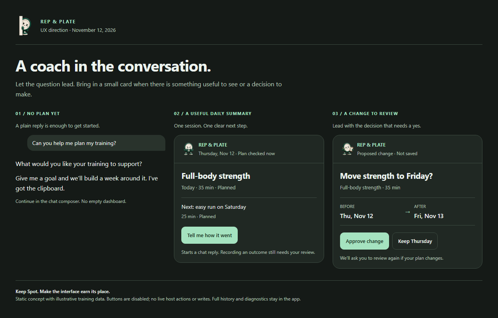

# Rep & Plate MCP experience investigation

November 12, 2026. Reviewed source at `1f422a7`, the supplied screenshot, and the actual HTML renderer in a synthetic browser host. Recommendations are proposed and await user review. No production behavior, account data, server configuration, or deployment was changed.

Historical investigation record. A subsequent user request authorized a local implementation; see [implementation and verification](implementation.md). The measurements and source references below describe the original `1f422a7` renderer. The retained investigation script asserts those original behaviors and is not a passing regression check for the improved renderer.

**Recommendation: keep Spot and make the interface selective.** Use conversation to establish a goal and answer simple questions. Show a small card for a useful daily summary or a concrete decision. The current coaching card brings the information density of an application dashboard into a conversation, even when there is no plan to summarize.



[Open the static concept](concept.html). All training examples are synthetic. The concept's disabled buttons illustrate placement and wording; they do not call tools, send messages, or save changes.

## What produces the screenshot

```text
Training or training-related food conversation
  → assistant is instructed to call get_coaching_day
  → saved state, weekly review, nextSteps, freshness, and Spot note
  → projected result plus coaching HTML resource
  → host renders Spot + full dashboard
  → assistant is also instructed to close its reply with Spot's line
```

The UI is a real HTML MCP App, with built-in PNG poses, rather than a generated image of the dashboard. The user's screenshot corresponds to the coaching resource in `server/agents/coaching-app.ts`.

- `scripts/agents/coaching-mcp.ts:198` links a UI resource to the read tool. The description at line 224 asks the assistant to call it broadly for training, completed workouts, eating around training, or the week. This makes a dashboard eligible to appear during many ordinary exchanges; a user message alone does not render it. Actual display is controlled by the host and its support for MCP Apps.
- `server/agents/service.ts:104` combines current saved coaching state with a brief, weekly review, imported evidence, and prioritized next steps. Freshness is calculated separately for app-recorded food/workouts at lines 94–100.
- `scripts/agents/coaching-mcp.ts:88` projects the result into a bounded view; line 138 retains `nextSteps`. `freshnessView` at line 156 explicitly distinguishes the saved coaching plan from app-record snapshots.
- `server/agents/coaching-app.ts:99` renders one fixed dashboard for all states. The markup at lines 241–249 always includes today, upcoming, this week, review, recent changes, and a raw-state disclosure.
- `server/agents/spot-banner.ts:16` supplies the shared artwork and speech bubble. The basic tools use a separate small Spot-only resource through `server/agents/mcp-server.ts:51` and `server/agents/spot-app.ts`.

Recent history explains the approach: `f3ad8fa` made new connections coaches by default; `2966218` strengthened the voice instruction; `f222981` added the drawings; `1f422a7` broadened protocol compatibility. The comment in `src/features/spot/assistant.ts:1` records earlier trials in which optional voice instructions were ignored. That is useful history, but I did not repeat those live assistant trials and it does not establish today's preferred UX.

## Findings, in priority order

| Priority | Finding and evidence | Recommended response |
| --- | --- | --- |
| High | **The freshness warning describes the wrong thing.** `server/agents/coaching-app.ts:107` turns `freshness.stale` into “Refresh before changing the plan.” The projected summary at `scripts/agents/coaching-mcp.ts:156` explicitly says it applies only to app-recorded food/workouts. With no app snapshot, the synthetic read has current saved plan state and a stale flag. Refreshing reproduces the same warning. | Distinguish plan read/revision from app-record availability. Show a specific missing/old-record note only when advice relies on those records. A refresh must not imply it can create missing device data. A previously rendered plan can still age; retain fresh reads and revision checks for writes. |
| High | **The empty state offers little progress.** At `coaching-app.ts:113–123` and `241–249`, multiple empty sections, zero counts, and overlapping missing-data statements remain visible. The no-goal fixture is 1,071 CSS px tall at 390px wide and 926px at 760px. The only immediately visible header action is refresh. | Ask one useful goal question in conversation. Omit the empty dashboard. For an explicitly requested overview, use a compact setup state with a clear conversational next step. Keep missing records distinct from actual zero activity. |
| High | **The important decision is below general reporting.** The review section follows the entire weekly section. With one simple reschedule proposal, the apply control starts at y=1,362 CSS px on the 390px-wide fixture; the whole card is 1,572px tall. | Give a proposed change its own focused card. Lead with the changed session/date and before/after. Preserve explicit approval, stable request IDs, conflict rejection, and guarded undo. Routine daily summaries should not precede an urgent review inside the same card. |
| Medium | **Useful context never reaches the card.** The renderer does not consume `nextSteps` or imported `evidence`. In the imported-run fixture the tool has a named Strava activity and a next step asking whether it matches yesterday's planned session; neither the activity nor that question appears in the rendered body. `coaching-app.ts:99–125` displays totals and generic missing-data copy instead. | Translate one prioritized next step into a user-facing question or action. When a source record matters, show a short source-labeled fact. Never treat an imported activity as confirmation that a planned session was completed. Do not display internal assistant instructions verbatim. |
| Medium | **The same joke can appear twice.** `spot-banner.ts:30` displays `spot.says`; `src/features/spot/assistant.ts:93` also requires the assistant to quote it at the end of its reply. `spotLine` at line 81 selects a stable line per moment/day. Repeated reads in the same state/day return the same line. Duplication is established by the presentation contract; actual assistant compliance was not measured here. | Keep a light, recognizable voice. Assign the line to one surface. Avoid a mandatory quoted sign-off on every result. A first-use welcome or meaningful milestone can carry more character; ordinary replies can stay concise. |
| Medium | **A host theme update does not change the custom palette.** `coaching-app.ts:216,228` sets `colorScheme`, while the colors at line 8 still depend on the browser's `prefers-color-scheme`. In a dark browser with a light host context, the inline scheme becomes light while the card background remains dark green (`rgb(16,35,28)`). | Derive custom colors from the host's theme or styles, with a browser-preference fallback when context is absent. Verify both disagreement directions and live theme changes. Retain mint as an accent. |

Secondary cleanup: raw ISO dates and revision numbers compete with the content; the raw JSON disclosure creates nested scrolling when opened (`coaching-app.ts:8,249`). Human-readable local dates and meaningful “checked” status can stay visible; raw state belongs in diagnostics. Preserve access to detailed source data when a user explicitly asks for it.

The artwork is already small: the complete coaching resource is 117,447 UTF-8 bytes and the Spot-only resource is 96,858 bytes, each including nine built-in poses. No latency or host cache measurements were made, so these sizes do not establish a performance problem. Optimize relevance and card height before replacing the image pipeline.

## Proposed behavior

| Situation | Default response | Role for Spot |
| --- | --- | --- |
| No agreed goal | One question in chat | Voice; optional first-use introduction |
| Simple food/training question or background read | Concise chat response, grounded in saved data | Light phrasing without a compulsory extra quote |
| User asks for today's plan | Small session summary with one useful action; at most one secondary action | Small avatar/brand accent |
| Goal exists but no sessions | Offer to draft a week around the saved goal and constraints | Short contextual line if useful |
| Change needs approval | Focused before/after card with explicit approve/dismiss | Small accent; decision remains dominant |
| Write succeeds | Short confirmation tied to the actual result; undo where supported | Milestone treatment used sparingly |
| Weekly review requested | Focused review of that period; unknown outcomes remain unknown | Optional character detail |
| Host cannot render or call tools | Complete text response and clear text-based review path | Voice preserved; no dependence on an image |

The mockup uses a 36px mascot in useful cards and retains the current mint/green identity. That dimension is a design hypothesis, not a measured optimum. The daily action starts a conversational report; it must not mark anything done. The review concept uses a clearly labeled approval action; replacing the current checkbox would require validating equally explicit authorization and the exact proposal being approved.

[OpenAI's inline-card guidance](https://developers.openai.com/plugins/concepts/ui-guidelines#inline-card), fetched during this investigation, supports focused cards with a small amount of structured information, no more than two primary actions, and content that avoids deep navigation or internal scrolling. [Vercel's interface review guidance](https://raw.githubusercontent.com/vercel-labs/web-interface-guidelines/main/command.md), also fetched, informed the checks for empty states, image dimensions, focus affordances, locale formatting, and theme behavior. The prioritization above is my assessment of this product, rather than evidence from user testing.

## Implementation boundaries for a later change

1. Separate background data access from visible presentation. Keep `get_coaching_day` available to ground the assistant's answer. Add an explicit summary presentation tool, or another host-supported deliberate presentation path, so a read does not always request a dashboard. Do not depend on a CSS-hidden widget alone: some hosts can still display its surrounding tool chrome.
2. Preserve the existing review resource path. Correction on closer source review: `propose_coaching_change` already attaches the same `ui` resource hint as `get_coaching_day` (`scripts/agents/coaching-mcp.ts:228–232` at `1f422a7`). Its earlier classification as visibility-only was incorrect. An action inside the existing card also ingests the returned proposal. Improve and test these existing paths rather than adding a replacement presentation tool. Exact rendering in a live conversation host remains a separate check.
3. Extend/repair the existing renderer and shared banner rather than creating a second coaching state store. Render by situation and intent: setup, daily summary, proposal, or receipt. Suppress empty sections, limit repeated material, and format dates for the user's locale.
4. Preserve canonical service behavior in `server/agents/service.ts` and `src/features/coaching/model.ts`. Reading is distinct from proposing; proposing is distinct from applying; imported evidence is distinct from reported completion. UI simplification is not authorization to auto-apply changes.

The lowest-risk first slice is the freshness wording plus empty-state hierarchy and hiding empty sections. The broader, higher-value change is separating routine reads from deliberate cards. Removing automatic UI trades some constant brand exposure for less conversational interruption; the assistant's voice and focused cards can still carry the identity.

## Evidence and limits

Run the retained reproduction with:

```powershell
node --import tsx docs/audits/2026-11-12-mcp-ux/investigate.mts
```

It uses the real renderer, CSP, shared models, result projection, browser layout engine, and images. The parent host and all records are synthetic. No user account or live assistant is accessed. The reproduction deliberately asserts the existing undesirable behaviors; a passing run confirms the findings, not a product fix.

| Check | Result |
| --- | --- |
| Actual coaching HTML at 390px and 760px | Eight renders passed: empty, planned sessions, pending reschedule, imported activity |
| Missing app snapshot and refresh | Warning reproduced before and after read; scoped tool summary says plan data is current at read |
| Imported activity relevance | Projected source record and next step present; absent from visible card |
| Approval gate | Apply disabled before review; enabled after checking approval; no live write attempted |
| Host without server tool calls | Refresh disabled and text-tool guidance displayed |
| Host-light/browser-dark disagreement | Palette mismatch reproduced |
| Proposed layout | 320px, 390px, 1280px; no horizontal overflow, images decoded, buttons at least 44px tall |
| Visual inspection | Desktop concept, 390px concept, and current empty mobile screenshot inspected; text and controls readable |
| Focused existing tests | 44 tests across six files passed; includes MCP transport, projection, escaping/CSP, review, freshness, import boundaries, cancellation, and teardown |
| Production code changes | None; Git changes are confined to this audit directory |

Focused test command:

```powershell
node node_modules/vitest/vitest.mjs run server/agents/spot-cards.test.ts server/agents/spot-in-results.test.ts server/agents/mcp.test.ts server/agents/coaching-service.test.ts server/agents/coaching-import.test.ts scripts/agents/coaching-mcp.test.ts
```

Machine-readable measurements and visible text are retained in [browser-evidence.json](browser-evidence.json). Representative actual renders: [empty mobile](current-blank-390.png), [pending review mobile](current-pending-390.png), [imported-record state](current-imported-390.png). The concept's [mobile view](concept-390.png) is a vertical presentation of the three separate scenarios, not a proposed single 1,500px widget.

The first harness attempt failed because TSX injected a named-function helper into a serialized browser callback. Removing that local callback helper repaired the harness; no product code was involved. An intermediate imported fixture omitted the evidence projection; it was corrected before establishing the imported-record finding and all renders were rerun.

CYC managed startup encountered the previously documented source-fingerprint ceiling before creating a run (`docs/context/error-ledger.md:13`; `docs/context/agent-connections.md:24`). The exact error was “Source fingerprint exceeds 20,000 files or 128 MiB of selected source; review source exclusions or narrow the project.” Direct focused checks completed without changing the engine or verification policy. No controller-managed completion is claimed.

This is a completed investigation and an unimplemented design proposal. It does not establish preference, retention, assistant compliance, exact live-host card sizing, or live cross-host interoperability. The full application build/browser suite was not run for these audit-only files. Before rollout, exercise empty, goal-only, active, pending, stale-proposal, imported-record, error/retry, and text-only paths in the actual supported hosts. Compare comprehension of the next step, successful review completion, scrolling needed to reach the action, and perceived repetition with representative users. Those outcomes remain unmeasured.
