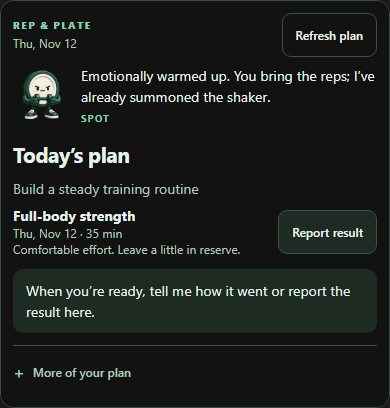

# Compact Spot responses — local implementation

November 12, 2026. Implemented following the user's request to try a small Spot illustration with sass and useful information inside Claude Chat. This extends the existing MCP Apps renderer. No deployment or account writes were performed. The implementation is available locally for review; preference and live-Claude presentation remain unmeasured.

## Result

The coaching read now shows a small 56px Spot illustration and a short situational response. A blank plan asks one goal question. A planned day shows the session and a reporting action. The wider plan, weekly reporting, source-data freshness and history are available under **More of your plan**. A pending proposal takes precedence over the daily summary, so its before/after and approval controls appear directly after Spot.

The small basic-tool card uses the same reduced artwork and host-theme behavior. The assistant instructions retain Spot's warmth and sass while asking it to avoid repeating a joke already shown in the card; text-only hosts still receive the line and complete structured/text result. Actual model compliance is not claimed.

### Example from the actual renderer

The training records in this screenshot are synthetic. This is the implemented HTML, not a static image sent as the product UI. Its text stays selectable and controls remain interactive. Only Spot's illustration is a PNG. The example host supplies the frame and uses the actual MCP tool registry and service.

## Mechanism and boundaries

- `server/agents/coaching-app.ts` renders setup, today/upcoming, earlier-session follow-up, or proposal state. It keeps a wider-plan disclosure instead of the always-visible dashboard. The raw whole-state JSON disclosure was removed. Exact changed values remain available while reviewing a proposal.
- `server/agents/coaching-style.ts` owns the compact layout. `spot-banner.ts` supplies the shared 56px artwork and text, plus host-theme handling. `spot-app.ts` applies the same theme and measures body content height so a card can shrink after its content changes.
- `scripts/agents/coaching-mcp.ts` adds one bounded, whitelisted earlier session under `brief.awaitingFeedback`. It enables a relevant question without exposing the entire historical plan. Today's planned-but-not-yet-reported session no longer selects Spot's overdue-report moment.
- An imported activity can be shown as a named source and a question about matching it to the earlier planned session. It never marks that session complete. Raw assistant-directed `nextSteps` instructions are not printed into the card.
- `assistant.ts` and the MCP-specific `spotCoachVoice` instruction in `personality.ts` no longer mandate a duplicate quoted sign-off. The separate in-app `spotVoice` is unchanged.
- The false stale-plan warning is removed. App-record availability/age stays explicitly scoped to app-recorded food/workouts under plan details. Revision checking still belongs to the canonical service, and previously rendered cards can age.
- Before/after outcome details now include the session name when available, date, reported minutes, effort and note. Profile priority/constraint arrays are visible in the review rather than silently omitted from its readable summary.

No canonical service mutation, authorization scope, confirmation token, idempotency mechanism, revision check or schema for saved health records was relaxed. Opening a reporting form does not save. Submitting proposes a change. Applying requires checking the review approval and pressing the apply action. If the service rejects a stale proposal, the card surfaces the error and a refresh leaves the old proposal disabled. Guarded undo remains in recent changes.

The proposal tool already attached the coaching resource in the original source. The earlier investigation's contrary note has been corrected. No new public presentation tool was needed.

## Review and retained findings

Self-review examined the intended experience, all named consumers of the shared banner/voice, empty and old data, imported evidence, denied host actions, duplicate requests, stale revisions, malicious text, CSP, unknown poses, and resize behavior. The important trade-off is less default reporting density while keeping details accessible. A compact card still appears when the existing tool metadata requests one; this change does not decouple background reads from visible presentation.

The initial new tests were deliberately run against the original code: six failed because compact state, host theme, earlier-session projection and nonduplicating voice behavior were absent. After implementation they passed. Existing voice expectations were changed because the user's requested compact character treatment should carry the line once, rather than require the same quote in the card and assistant reply.

The first mobile browser fixture lacked a viewport meta tag, causing a mobile browser to lay out a 760px card despite a narrow screen. This was a test-host defect. The host now has the correct meta tag and the test asserts the iframe's actual width at 320/390/760px; all affected renders were rerun before recording mobile evidence. Visual review then found the not-yet-overdue joke and missing visible reported minutes, which were corrected and covered by checks.

The existing CYC source-fingerprint ceiling prevented managed startup before it created a run. Direct configured verification is used without changing the engine or verification policy. No controller-managed completion is claimed. Reusable implementation findings are retained here and linked from agent-connection context; user acceptance is still pending.

## Verification

The durable browser regression lives in `tests/mcp-cards.spec.ts`. It hosts the actual CSP-protected HTML, registers the actual MCP tools through the official SDK's in-memory transport, and uses the canonical `AgentService` with isolated in-memory SQLite. It exercises real mutations on synthetic records, not mocked success messages. `server/agents/spot-cards.test.ts`, `server/agents/spot-in-results.test.ts`, and `scripts/agents/coaching-mcp.test.ts` cover projection, renderer and voice contracts.

Final command results and retained screenshots are recorded in `verification.json` after verification. This document and linked context were finalized before that verification. Live Claude rendering, user preference, and deployment remain outside the executed checks.
